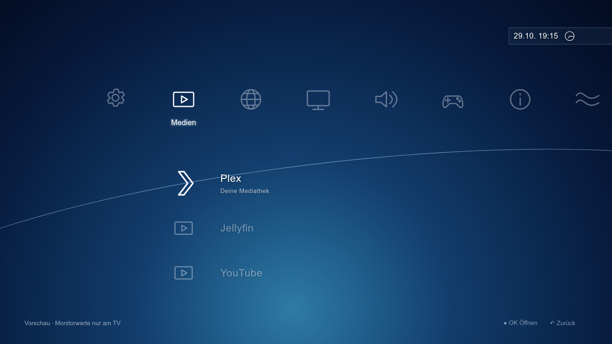
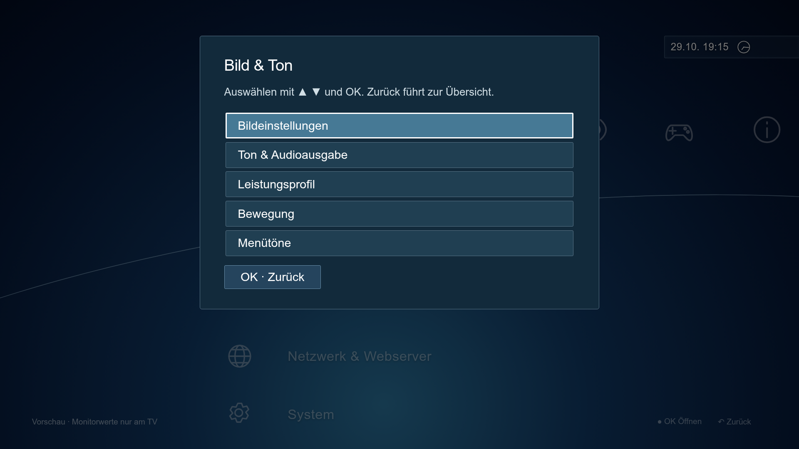
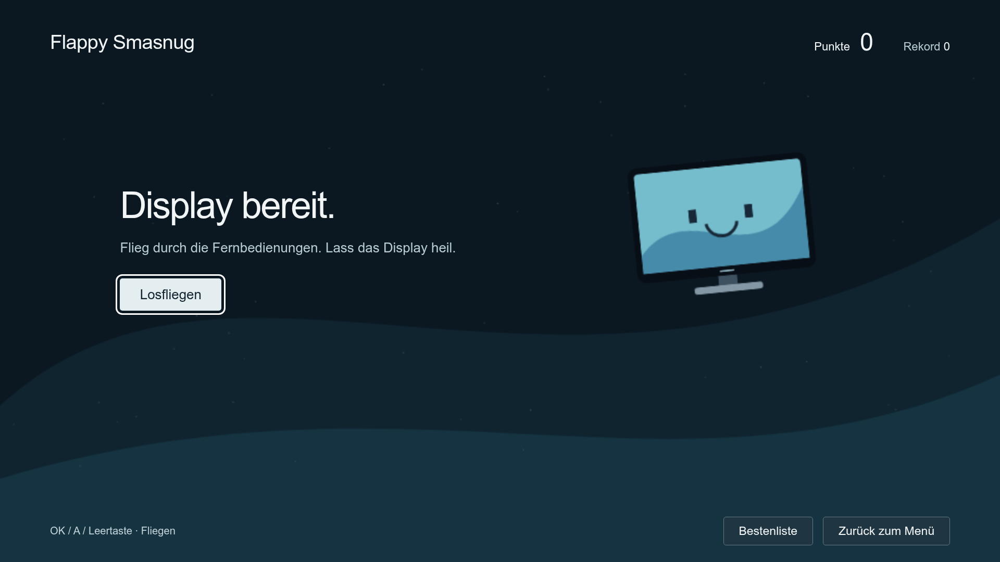

# Tizen Deck XMB

Ein Launcher im XMB-Stil für Samsung-Tizen-TVs und -Monitore. Starte Plex,
Jellyfin, YouTube und Moonlight, verwalte Favoriten und bediene den TV mit
Fernbedienung, Tastatur oder Controller. Mit Menütönen, verschiedenen
Leistungsprofilen, Uhr, Timer und dem kleinen Spiel Flappy Smasnug.

**Version 1.0 · Zum Großteil mit OpenAI Codex gevibecodet.**

## Screenshots

*Browser-Vorschau der aktuellen Version.*







## Bauen

Python 3.12+, curl und Internetzugang erforderlich:

```sh
git clone https://github.com/LabDennis/tizen-deck-xmb.git
cd tizen-deck-xmb
bash build.sh
```

Das Skript installiert Python-Abhängigkeiten in `.venv`, lädt den per SHA-256 geprüften offiziellen Tizen-Zertifikatgenerator und erzeugt `TizenDeckX.wgt`. Der Autorenschlüssel liegt lokal in `.signing/`: für Updates aufbewahren, niemals committen. Öffentliche SDK-Testzertifikate sind nicht dasselbe wie ein Samsung-Zertifikat für beliebige Retail-Geräte; Installation ist modellabhängig.

## Installieren

TV-Entwicklermodus und Netzwerk zuvor einrichten; vollständige [Anleitung](https://github.com/LabDennis/tizen-deck/blob/main/docs/GUIDE.md).

```sh
SDB=/pfad/zu/sdb bash install.sh 192.0.2.10
```

Getesteter optionaler Weg über temporären Root-Zugriff des Schwesterprojekts:

```sh
bash install.sh 192.0.2.10 --root-deck /absoluter/pfad/tizen-deck
```

IP ersetzen. Kein automatischer Fallback auf Root. Root-Unterstützung im Schwesterprojekt vorher explizit installieren. Start auf dem TV: `app_launcher -s TizenDeckX.XMB` über die SDK-Konsole von Tizen Deck. Paket-ID für eine bewusste Entfernung: `TizenDeckX`.

## Bedienung

Links/rechts wechselt die Kategorie, hoch/runter den Eintrag. OK öffnet,
Zurück schließt. Samsung Home bleibt über die Einstellungen erreichbar.
Plex, Jellyfin und Moonlight müssen separat installiert sein.

Für die Vorschau am PC:

```sh
python3 -m http.server 8766 --bind 127.0.0.1 --directory src
```

Danach http://localhost:8766 öffnen. TV-Funktionen sind nur am Gerät verfügbar.

## Kompatibilität

Entwickelt und getestet am Samsung M7 LS32BM700UUXEN mit Firmware
T-NKLBWWC-1720.7 und Tizen 6.5. Andere Modelle können abweichende App-IDs und
APIs haben. Langfristiges Speicherwachstum am TV ist noch nicht geklärt.

Der Updater akzeptiert nur neuere Versionen; für den Wechsel von einer höheren
Versionsnummer auf 1.0.0 ist eine manuelle Installation erforderlich.

## Weitere Infos

- [Webverwaltung und Debloat](https://github.com/LabDennis/tizen-deck)
- [Tests](docs/TESTING.md)
- [Entwicklung](docs/DEVELOPMENT.md)
- [Quellen und Drittprojekte](https://github.com/LabDennis/tizen-deck/blob/main/docs/PROVENANCE.md)

Datenschutz, Autoupdate und optionales Debloat: [English guide](https://github.com/LabDennis/samsung-smart-monitor-privacy).
